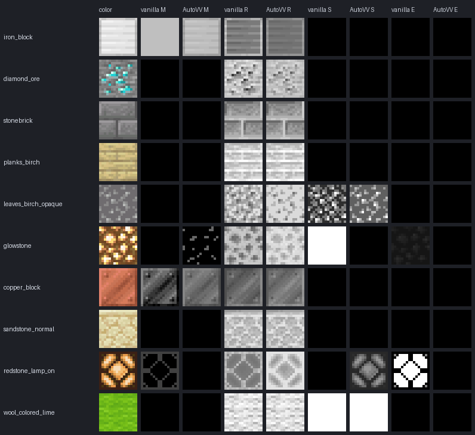

# AutoVV

AutoVV generates vanilla-style **MER/MERS maps** and **`texture_set.json`** files for Minecraft Bedrock
textures, so a resource pack works with **Vibrant Visuals** (and optionally RTX).

It doesn't use hand-made presets or a language model. It learned how Mojang authored the 1,271 vanilla
block MERS maps and reproduces that technique for your textures.



*Each row was generated by a knowledge base that had never seen that texture. Columns are vanilla vs AutoVV for
metalness, roughness, subsurface and emissive.*

## Features

- **Single file:** drag and drop (or browse to) a texture. It previews the color and the four generated channels live and
  saves `<name>_mers.tga` + `<name>.texture_set.json`.
- **Load pack:** lists every resource pack in your Minecraft Bedrock folders (current launcher, legacy UWP,
  Preview, development packs), or opens any pack folder. Textures appear in their real folder tree, with
  a thumbnail of each texture and a ✓ on those that already have MER/MERS. Nothing is ticked at first; tick files or whole folders (or use
  *Missing MER only*), then generate in one batch.
  - Writes in place or exports to a separate folder that mirrors the pack.
  - Existing texture sets are updated, not replaced, so `normal`/`heightmap` layers are kept.
  - After generating, AutoVV adds the `"pbr"` capability and a new enough `min_engine_version` to the pack's
    `manifest.json` if they're missing (a `manifest.json.bak` is saved first). Single File saves inside a pack do
    the same.
  - Right-click selected textures to set their material, or choose **Use existing MER/MERS**. That option
    opens a search box listing every MER/MERS file already in the pack. Pick one, and it's referenced directly if it
    sits in the same folder at the same size. Otherwise it's copied next to each texture (resized if needed).
- **Material checkboxes (optional):** Metal, Stone, Wood, Ore, Gem, Glass, Ice, Snow, Leaves/Foliage,
  Plant, Grass, Fabric/Wool, Concrete, Terracotta and Soil/Sand. These categories follow the
  MERS trends found in vanilla. Tick one, or leave all unticked to auto-detect.
  - **Assign to colors:** gives the ticked material to chosen colors only (e.g. the gray tools on a crafting table
    → Metal). That preset stays ticked and highlighted, and hovering it lists its colors. You can then tick another
    material for the colors that are left. Colors that already belong to a preset are grayed out in the
    other presets' dropdowns, so they can't be taken over. Clicking a highlighted preset selects it for
    editing (it keeps its colors); **Remove** in its dropdown frees them. Once every color has a
    material, the other presets are disabled. Assigned colors get exactly the values they would have if the whole
    texture were that material, so they still vary with brightness. A Metal you choose is always metallic.
  - In Load Pack mode, the ticked preset applies to all ticked textures, while color assignments are saved per
    texture as you preview it.
- **Channel editor:** click the Metalness, Emissive, Roughness or Subsurface preview to edit that channel
  (below the material section).
  - **Colors:** every color in the texture is a swatch, sorted by hue (grays last). The first 15 are shown, with
    **See all** for the rest. Textures with more than 256 colors are grouped into 64 similar-color
    swatches. Click one to show its slider under the swatches.
    The slider sets that channel's value for exactly those pixels, and **Auto** goes back to the learned value.
  - A short description under the previews says what white and black mean for the selected channel.
  - **Overall:** the slider rescales the channel's learned values so their peak equals the slider, keeping the
    variation. On an empty channel (e.g. no glow yet) it fills it. Colors you set by hand are not affected.
  - **Glow:** AutoVV never makes anything glow by itself. Use the Emissive editor, e.g. click a torch's
    flame colors and set them to about 40–60, or set Overall to about 40 for a glowstone-like block.
  - In Load Pack mode, edits are kept per texture and shown as "✎ edited".
- **Optional Ollama integration:** reads only the texture's *name* to work out its material (e.g.
  `nickel_block` → Metal). It never produces pixel values.
- **Learn tab:** re-runs the learning session on any vanilla folders (blocks, items, entity) and shows the report.
- MERS (Vibrant Visuals, format `1.21.30`) or MER (RTX-compatible, format `1.16.100`), as TGA (like vanilla) or PNG.
- Every slider has a number field you can type into. **Settings → Slider values** switches between 0–255 and
  percent; files are always written as 0–255.

## Install and run

Requires Python 3.10+.

```bash
pip install -r requirements.txt
python -m autovv            # opens the GUI  (or double-click run_autovv.bat)
```

The trained knowledge base ships in `autovv/data/knowledge_base.json`, so no training is needed to start.

### Command line

```bash
python -m autovv generate path/to/nickel_block.png --material metal
python -m autovv generate textures/*.png --mode mer --format png --out build/
python -m autovv packs                        # list discovered resource packs
python -m autovv scan "path/to/MyPack"        # textures + MER status
python -m autovv train --source "…/bedrock-samples/resource_pack/textures/blocks"
```

## How the learning works

The learning session (`autovv/trainer.py`) reads every vanilla `*.texture_set.json` that has an image
MER/MERS layer and compares the color texture with its map, pixel by pixel. What it found:

1. **Every channel is a linear "levels" remap of brightness inside a material region.** Grayscale is
   the plain mean of R, G and B, which fit better than Rec.601/709, linear-light or max-channel.
   Pixels are placed between their region's darkest and brightest value and mapped onto a
   per-material band. For roughness, dark pixels are rough and highlights are smooth. The median error of this
   model on vanilla regions is **0.5 / 255**. Curved (gamma) mappings fit clearly worse.
2. **Each material uses a fixed preset band.** Stone is 225→151, wood 229→163, metal 196→108 with M ≈ 128–191,
   gems 201→105 with S = 255, and glass is M 89 / R 0. The full table is in the
   [training report](autovv/data/training_report.md).
3. **Mixed textures are several regions.** Ore specks and metal fittings on wood each carry their own preset.
   The trainer finds these regions from the real maps. It also
   clusters every vanilla texture the way the generator will cluster yours, and learns which color
   clusters vanilla treats as separate accent materials.
4. **Borders and crevices get no special treatment.** They are rougher only because they are darker.
   Only concrete shows a measurable extra crevice effect, and it is applied.
5. **Subsurface** is 255 on gems, ice, wool and slime. It follows brightness on leaves and plants and is 0 elsewhere.
   **Emissive** is deliberately not learned: vanilla's glow is excluded from training, and you decide what glows.
   **Grain:** about a quarter of vanilla regions (dirt, for example) have hand-added roughness noise, and the
   generator reproduces its amount.

Everything learned (1,688 region exemplars, 7,000+ labeled color clusters, per-material statistics)
is stored as plain JSON in `autovv/data/knowledge_base.json`.

### Generation

`autovv/generator.py` works in these steps:

1. Resolve the material, in this order: checkbox, name keywords, then Ollama if enabled. With no preset
   (e.g. slime or melon), it learns from the nearest vanilla textures of any kind. Metal, gem, glass, ice
   and ore are left out of that search, since guessing them from color alone looks worse than missing them.
2. Cluster the texture's colors.
3. Use the nearest vanilla clusters to decide which clusters are accent materials.
4. Predict each region's band from its nearest vanilla regions. Textures from the same name family
   (such as a pack's retexture of `iron_block`) count as closer.
5. Apply the levels model and the learned grain.
6. Bleed values into transparent pixels so mip-maps stay clean.

The output is deterministic.

### Accuracy

The learning session includes a 5-fold hold-out test. Each vanilla texture is regenerated by a knowledge base that
never saw it, and compared with the real map. Values are the mean absolute error on a 0–255 scale:

| Channel | AutoVV | New modded name (name-blind) | Flat per-material preset |
|---|---|---|---|
| Metalness | 5.6 | 7.7 | 11.7 |
| Emissive | 1.3 (not learned, left to you) | 1.3 | 1.3 |
| Roughness | 15.1 (median 8.4) | 17.0 | 31.7 |
| Subsurface | 20.6 | 25.7 | 34.1 |

The per-pixel roughness pattern correlates with vanilla at a median of **0.995**. Most remaining error comes from
vanilla being inconsistent with itself. For example, red wool has subsurface 255 while bed tops have 0. And near-identical
plants range from 8 to 255.

## Ollama (optional)

1. Install [Ollama](https://ollama.com) and pull a model:
   - **Recommended:** `ollama pull qwen2.5:7b`. It has good general knowledge (osmium is a metal, agate is a gem), follows
     JSON-schema output reliably, and needs about 5 GB of RAM or VRAM.
   - **Low-end PCs:** `ollama pull llama3.2:3b` (about 2 GB). It is faster, but less reliable on obscure material names.
   - Models that "think" (reasoning models) are slower and don't help with this one-word question.
2. In **Settings**, tick *Use Ollama*, press **Load models**, pick one and save.
3. To compare the models you've pulled on 30 known material names:
   `python -m autovv ollama-bench qwen2.5:7b llama3.2:3b`

AutoVV asks the model one constrained question: which of its material categories the name refers to.
The answer must be a valid category and is cached. By default Ollama is only asked when the keyword list
doesn't recognize a name. Tick *verify* to have it check every name.

AutoVV never infers a material from block sounds (the `sound` field in `blocks.json`), because Minecraft
often gives a block the sound of a different material. Ollama is also told to judge only by what the thing is made of.

## Notes

- Vibrant Visuals only loads texture sets from packs whose manifest has `"capabilities": ["pbr"]` and
  `min_engine_version` ≥ 1.21.120. AutoVV adds both automatically when they're missing.
- A texture set may reference only images in its own pack, and must not define both MER and MERS.
  AutoVV keeps to both rules.
- Rewriting `manifest.json` drops any comments it contained; the `.bak` copy keeps the original.

## Project layout

```
autovv/
  trainer.py       learning session, hold-out evaluation, report
  regions.py       region features and the levels model
  knowledge.py     knowledge base storage and nearest-neighbor queries
  generator.py     MERS synthesis
  materials.py     material taxonomy and name keywords
  pack.py          pack discovery, scanning, manifest update
  texture_set.py   texture_set.json read/merge/write
  pipeline.py      file → map + texture set
  ollama_client.py optional name → material helper
  gui/             PySide6 interface
  data/            knowledge_base.json, training_report.md
tests/             pytest suite
```

Reference: [Vibrant Visuals documentation](https://learn.microsoft.com/en-us/minecraft/creator/documents/vibrantvisuals/?view=minecraft-bedrock-stable).
